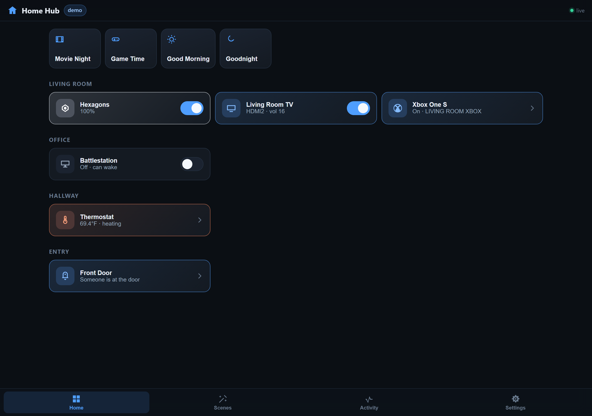

# pi-smart-home-hub

A self-hosted smart home hub for a Raspberry Pi 4 that controls **Nanoleaf
panels**, a **TCL TV**, an **Xbox One S**, a **desktop PC**, an **Ecobee
thermostat** and a **Ring doorbell** from one dashboard — no vendor apps, no
cloud relay for the things that work locally, and no account anywhere but your
own.



It runs on the Pi as a systemd service and serves a touch-friendly web
dashboard to any phone, tablet or browser on your LAN.

---

## Try it right now

No hardware needed. The hub ships with a demo profile that swaps the network
layer for in-process device simulators and runs the **exact same adapter
code**, so every control, scene and automation genuinely works:

```bash
npm install
npm run build
npm start
```

Open <http://localhost:8080>. Dim the panels, switch the TV to HDMI 2, wake the
Xbox, nudge the thermostat, and press **Activity → Ring the demo doorbell** to
watch an automation fire.

---

## What it actually does

| Device | How it is controlled | What you get |
| --- | --- | --- |
| **Nanoleaf** (Shapes / Canvas / Lines / Light Panels) | Local HTTP API, port 16021 | On/off, brightness, colour, white temperature, effects, identify |
| **TCL TV** (Roku TV models) | Roku ECP, port 8060 | Power, volume, mute, full remote, HDMI inputs, launch apps, type text, now-playing |
| **TCL TV** (Google/Android TV models) | ADB over TCP | Power, volume, remote keys, inputs, launch packages |
| **Xbox One S** | SmartGlass discovery + power-on, UDP 5050 | Wake from standby, online status, console name. *Power off is not possible — see below* |
| **PC** | Wake-on-LAN, plus an optional companion agent | Wake; and with the agent: sleep, shutdown, restart, lock, live status |
| **Ecobee** | Official API, OAuth PIN flow | Temperature, humidity, setpoints, HVAC mode, fan, holds, resume schedule, remote sensors |
| **Ring doorbell** | The app's own API, OAuth + 2FA | Battery and wifi health, motion/ding event feed, on-demand snapshots, floodlight and siren |

Plus:

- **Scenes** — ordered lists of commands across devices, with delays. "Movie
  night" powers the TV on, waits for it to wake, switches to HDMI 2 and drops
  the panels to 12%.
- **Automations** — triggered by a hub event (`ring.ding`), a cron schedule, or
  a device state crossing a threshold, with cooldowns and time windows.
- **Live updates** — state is pushed over a WebSocket, so two tablets stay in
  sync and nothing polls the hub.
- **Discovery** — finds Nanoleaf controllers, Roku TVs and an awake Xbox on the
  LAN and prints config you can paste in.

---

## Install on the Pi

Raspberry Pi OS 64-bit (Bookworm) on a Pi 4. Everything here is pure
JavaScript, so `npm ci` has nothing to compile on ARM.

```bash
git clone https://github.com/MOTOMOTO2/pi-smart-home-hub
cd pi-smart-home-hub
sudo ./deploy/install.sh
```

The installer adds Node 20 if needed, creates a `hub` service user, builds
everything, installs a hardened systemd unit and starts it. Then:

```bash
sudo -u hub nano /opt/pi-smart-home-hub/config/hub.yaml   # your devices
sudo nano /etc/pi-smart-home-hub.env                      # your secrets
sudo systemctl restart pi-smart-home-hub
```

Useful afterwards:

```bash
sudo journalctl -u pi-smart-home-hub -f    # logs
npm run hub -- devices                     # device status from a shell
npm run hub -- discover                    # scan the LAN
```

---

## Configuration

Copy `config/hub.example.yaml` to `config/hub.yaml` — it is heavily commented
and is the real reference. `config/hub.yaml` is git-ignored.

```yaml
server:
  port: 8080

network:
  broadcastAddress: 192.168.1.255   # helps Wake-on-LAN and Xbox wake

devices:
  - id: lights
    name: Living Room Panels
    type: nanoleaf
    room: Living Room
    host: 192.168.1.41

  - id: tv
    name: Living Room TV
    type: rokutv
    room: Living Room
    host: 192.168.1.52
    mac: "9C:76:0E:44:55:66"

scenes:
  - id: movie-night
    name: Movie Night
    icon: film
    favorite: true
    actions:
      - { device: tv, command: power, params: { on: true } }
      - { delayMs: 2500 }
      - { device: tv, command: input, params: { input: hdmi2 } }
      - { device: lights, command: brightness, params: { value: 12 } }

automations:
  - id: doorbell-lights
    name: Flash the lights when someone rings
    when: { event: ring.ding }
    cooldownSeconds: 30
    run:
      - { device: lights, command: color, params: { hex: "#ffffff" } }
      - { device: lights, command: brightness, params: { value: 100 } }
```

Secrets never belong in the YAML. Any string can reference the environment as
`${VAR}` or `${VAR:-default}`, resolved from `/etc/pi-smart-home-hub.env`:

```yaml
apiKey: ${ECOBEE_API_KEY}
```

Run `npm run hub -- discover` to get IP addresses and a pasteable config block
for anything on the LAN that announces itself.

---

## Pairing

Three devices need credentials. Open the device tile in the dashboard and
press **Pair** — or do it over SSH with `npm run hub -- pair <id>`.

- **Nanoleaf** — hold the controller's power button for 5–7 seconds until the
  LED flashes, then press Pair. The hub is handed a token and stores it.
- **Ecobee** — needs your own free developer key (ecobee.com → Developer →
  Create New Application, auth method "ecobee PIN"). Press Pair for a
  4-character PIN, add it at ecobee.com under My Apps → Add Application, then
  press Complete.
- **Ring** — sign in with your Ring email and password, then the 2FA code Ring
  texts or emails you. Only the resulting refresh token is stored; the
  password is never written to disk.

Tokens live in `data/state.json`, which is mode 600 and git-ignored.

---

## Honest limitations

These are protocol facts, not missing features:

- **The Xbox cannot be turned off.** Waking a console needs no authentication,
  but anything beyond that — power off, launching a game, sending input —
  requires a cryptographically paired SmartGlass session backed by an Xbox
  Live sign-in. That would mean storing Microsoft account credentials on the
  Pi, which is not a trade this project makes. Set the console to
  **Instant-on** power mode for wake to work at all.
- **A Roku TV in standby may not answer.** Enable *Settings → System → Power →
  Fast TV Start*, or set `mac` so the hub can fall back to Wake-on-LAN.
- **Ring has no public API.** The hub speaks the same endpoints the mobile app
  does. It can break if Ring changes them, and it rate-limits hard — do not
  set `pollSeconds` below about 30. Live video is WebRTC and stays in the Ring
  app; the hub does stills and the event feed.
- **Ecobee aggregates on a ~3 minute cadence**, so polling it faster just
  burns API quota.
- **PC sleep/shutdown needs the companion agent** in `agents/pc-agent/`. Wake
  works with nothing installed, but nothing in the network stack can put a PC
  to sleep on its own.
- **mDNS discovery is not implemented.** Discovery uses SSDP (Nanoleaf, Roku)
  and the SmartGlass broadcast (Xbox). Android TV sets announce nothing — get
  the IP from the TV's network settings screen.

---

## How it is put together

```
server/          Node + TypeScript hub
  src/devices/   one adapter per device type
  src/protocols/ SmartGlass, Wake-on-LAN, SSDP, Roku XML
  src/net/       the Transport interface, the real one, and the simulators
  src/hub.ts     device registry, polling, scenes, automations
web/             React + Vite dashboard
agents/pc-agent/ zero-dependency agent for the PC
deploy/          systemd unit, installer, kiosk notes
docs/            device notes and the HTTP API reference
```

Two decisions shape everything else:

**Adapters declare capabilities, not types.** Each adapter publishes what it
can do (`power`, `brightness`, `color`, `thermostat`, `camera`, …) and the
parameters each command accepts. The dashboard renders controls from that
metadata rather than switching on device type, so the scene builder offers
exactly the right parameters and a new adapter gets a working panel for free.

**Adapters never touch the network directly.** Everything goes through an
injected `Transport`. The production one does HTTP, UDP, TCP probes and
subprocesses; the demo one answers from in-process device simulators. That is
what makes `npm start` useful with no hardware, and it means the tests assert
on the exact bytes an adapter puts on the wire.

Dependencies are deliberately few and all pure JavaScript — express, ws, zod,
js-yaml on the server; React on the client. The Roku XML reader, the cron
matcher and the SmartGlass codec are each a few dozen lines rather than a
dependency that needs a compiler on an ARM board.

---

## Development

```bash
npm install
npm run build          # server + dashboard
npm start              # http://localhost:8080 (demo profile)
npm test               # 121 unit tests
npm run smoke          # boots the server, drives the HTTP API and WebSocket
npm run verify         # typecheck + build + test + smoke
```

For UI work, run the hub on 8080 and Vite separately — it proxies `/api` and
`/ws` through:

```bash
npm start
npm run dev --workspace web      # http://localhost:5173
```

The browser check drives the built dashboard in headless Chromium and fails on
any console error. Playwright is deliberately not a project dependency:

```bash
npm install --no-save playwright && npx playwright install chromium
node scripts/ui-check.mjs            # add --headed to watch it
```

Together those are 245 checks: 121 unit, 75 against the live HTTP API and
WebSocket, and 49 in a real browser.

---

## Security

The hub is built for a trusted home LAN and ships with authentication off.
If you share wifi with guests — or, please don't, forward a port — set a token:

```yaml
auth:
  token: ${HUB_TOKEN}
```

Every API call and WebSocket connection then needs it; the dashboard will ask
once and remember it. To reach the hub from outside your house, use a VPN
(WireGuard, Tailscale) rather than exposing it. Nothing here is hardened for
the open internet.

The systemd unit runs as a non-root user with `ProtectSystem=strict` and write
access only to `data/`.

---

## Assumptions made

A few things the request left open, resolved the conventional way and noted
here rather than buried:

- **TCL TV** is assumed to be a **Roku TV**, which covers most TCL sets sold in
  North America. An `androidtv` adapter is included for Google TV models —
  swap the `type:` in config. Check which you have by opening
  `http://<tv-ip>:8060/query/device-info`; if it answers, it is a Roku TV.
- **Ring** is read-mostly on purpose: health, events, stills, floodlight and
  siren. Live video would mean a WebRTC stack and a much larger dependency
  surface for something the Ring app already does well.
- **The Ring client is hand-written** rather than using `ring-client-api`, to
  keep the dependency list short and pure-JS. The trade-off is no push
  notifications — the hub polls the event feed instead.
- **Temperatures default to Fahrenheit** (`scale: F` on the Ecobee device),
  matching the Ecobee API's native unit. Set `scale: C` for Celsius.

---

## Licence

MIT.
